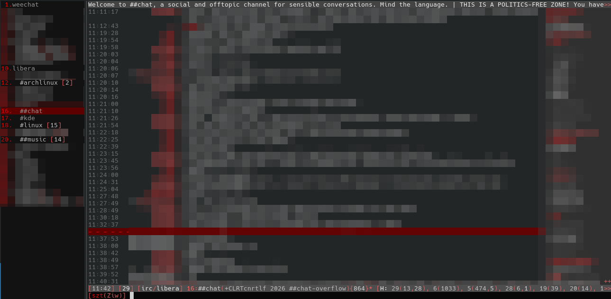
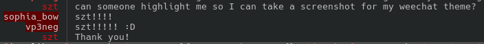

# Obsidian for WeeChat

A dark theme for [WeeChat](https://weechat.org/), pairing charcoal and black
surfaces with muted gray text and bright red accents.

The theme is provided in [`obsidian.theme`](obsidian.theme), exported with
WeeChat 4.10.1.

## Features

- Red accents for your nickname, buffer numbers, and unread activity.
- Dark red backgrounds for highlighted nicknames and the current buffer.
- A red read marker across the chat area.
- Muted timestamps, joins, quits, and backlog messages.
- Coordinated colors for the buffer list, nicklist, title, status, and input bars.
- Color settings for IRC, fset, scripts, relay, and file transfers.

## Screenshots

### Channel overview



The theme in use, with the buffer list on the left, nicklist on the right,
and red accents marking the current buffer, nicknames, and read marker.
The chat background follows the terminal's background color.

### Highlights



Highlighted nicknames stand out with light text on a dark red background.

## Installation

Use a WeeChat version with the built-in `/theme` command; check with
`/help theme`. A terminal with 256-color support and a dark background is
recommended. The main chat background uses your terminal's default background.

1. In WeeChat, save your current appearance:

   ```text
   /theme save before-obsidian
   ```

2. From this repository's directory, copy the theme into your WeeChat
   configuration directory:

   ```sh
   mkdir -p "${XDG_CONFIG_HOME:-$HOME/.config}/weechat/themes"
   cp obsidian.theme "${XDG_CONFIG_HOME:-$HOME/.config}/weechat/themes/"
   ```

   If you use a custom configuration directory or `~/.weechat`, put
   `obsidian.theme` in its `themes/` subdirectory instead.

3. In WeeChat, apply the theme and save the resulting settings:

   ```text
   /theme apply obsidian
   /save
   ```

See the [WeeChat theme documentation](https://weechat.org/files/doc/weechat/stable/weechat_user.en.html#themes)
for theme commands and backup behavior.

## Restore your previous appearance

If you saved it during installation:

```text
/theme apply before-obsidian
/save
```

## Customization

Edit the color and format options in `obsidian.theme`, copy the updated file into
your `themes/` directory, and run `/theme apply obsidian` again. Use `/save` to
keep the changes across restarts.

The theme includes formats as well as colors, including timestamps and message
prefixes. Plugin and bar options take effect when those components are available;
your terminal palette and existing layout also affect the final appearance.
